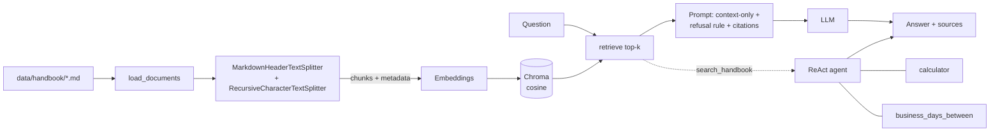

# Handbook RAG: retrieval-augmented QA + ReAct agent (LangChain · Chroma · Python)

An end-to-end, testable project that answers questions about a company handbook using only retrieved
evidence, and that can solve multi-step questions by calling tools.

* **RAG pipeline**: ingest → section-aware chunking → embeddings → Chroma (cosine) → grounded answer with
  `[n]` citations and an explicit "I don't know" path.
* **ReAct agent**: a ~100-line Thought/Action/Observation loop with three custom tools
  (`search_handbook`, `calculator`, `business_days_between`).
* **Evaluation**: 24 labelled questions (factual, paraphrased, unanswerable) + 4 multi-step agent questions,
  retrieval and answer metrics, and a chunk-size/overlap sweep.
* **Pluggable models**: local Hugging Face, Ollama, OpenAI, or a zero-download offline mode for tests/CI.

The corpus (`data/handbook/`) is a *fictional* company's handbook. That is deliberate: the facts are not in any
model's training data, so a correct answer proves retrieval worked, and a made-up answer is easy to spot.

## Architecture



| File | Responsibility |
|---|---|
| `handbook_rag/ingest.py` | load, two-stage split with `source`/`section`/`chunk_id` metadata, build/load Chroma |
| `handbook_rag/rag.py` | `RagPipeline`: retrieval, prompt, refusal rule, optional distance guard |
| `handbook_rag/agent.py` | ReAct loop: parsing, tool dispatch, error recovery, step limit |
| `handbook_rag/tools.py` | custom tools, incl. an AST-based safe calculator (no `eval`) |
| `handbook_rag/evaluate.py` | hit@k, ctx@k, MRR, answer accuracy, refusal metrics, sweep |
| `handbook_rag/providers.py` | embedding / LLM factories + offline stand-ins |
| `app.py` | Streamlit web interface (ask, agent, evaluation) |
| `tests/` | 29 tests incl. a scripted-LLM test of the whole agent loop |

## Quickstart

```bash
pip install -r requirements.txt
python -m pytest -q                       # 29 tests, ~1 s, no downloads
python -m handbook_rag ingest             # offline demo mode (hash embeddings)
python -m handbook_rag ask "How many vacation days do I get?" --show-context
```

The default mode is **offline demo**: lexical hash embeddings and an "LLM" that just picks the best sentence.
It exists so the plumbing and tests run anywhere. **Its scores are not meaningful**; use a real model for results:

```bash
# Option A: fully local (no API key). Uncomment the "local" lines in requirements.txt, then:
pip install langchain-huggingface sentence-transformers "transformers>=4.56" torch accelerate
export RAG_EMBEDDINGS=huggingface RAG_LLM=huggingface
python -m handbook_rag ingest
python -m handbook_rag ask "What is the hotel cap in London?" --show-context
python -m handbook_rag eval --out eval/results/rag_hf.json

# The agent needs a stronger model than 1.5B; try 3B/7B, Ollama, or OpenAI:
export RAG_LLM_MODEL=Qwen/Qwen2.5-3B-Instruct
python -m handbook_rag agent "I have 4 years of tenure. How many vacation days remain after 2026-07-06 to 2026-07-17?" --trace
python -m handbook_rag eval --agent --out eval/results/agent_hf.json
```

Ollama: `RAG_EMBEDDINGS=ollama RAG_LLM=ollama RAG_LLM_MODEL=qwen2.5:7b`. OpenAI: `RAG_EMBEDDINGS=openai RAG_LLM=openai` + `OPENAI_API_KEY`.

## Web interface

```bash
pip install -r requirements.txt
streamlit run app.py          # opens http://localhost:8501
```

Three tabs: **Ask (RAG)** shows the cited answer and the retrieved passages with distances, **Agent** shows each
Thought / Action / Observation step, and **Evaluation** runs the retrieval metrics, the full evaluation with a
progress bar, and the chunk-size sweep. The sidebar switches embeddings, LLM, chunk size, overlap and top-k live
(the index is rebuilt automatically). Start with real models by setting the environment variables first:

```bash
export RAG_EMBEDDINGS=huggingface RAG_LLM=huggingface      # PowerShell: $env:RAG_EMBEDDINGS="huggingface"
streamlit run app.py
```

To put it online, push the repo to GitHub and deploy it on Streamlit Community Cloud (free) with `app.py` as the
entry point. That works with `openai` as the provider (add `OPENAI_API_KEY` as a secret); local Hugging Face
models are too large for the free tier.

## Experiments to run (this is where your CV claims come from)

Run these with a **real** provider and record what you actually get.

| # | Command | Question it answers |
|---|---|---|
| 1 | `python -m handbook_rag sweep --out eval/results/sweep.csv` | How do chunk size and overlap change hit@k / **ctx@k** (is the answer actually in the context)? |
| 2 | `RAG_TOP_K=1`, `2`, `4`, `6` + `eval` | How does retrieval depth trade recall against noise and wrong answers? |
| 3 | `python -m handbook_rag eval` | Overall accuracy, false-refusal rate, and **refusal accuracy** on unanswerable questions. |
| 4 | Edit the prompt in `rag.py` (remove rule 2) + `eval` | How much does the refusal instruction matter for hallucination? |
| 5 | `python -m handbook_rag eval --agent` | Can the agent do multi-step questions plain RAG cannot? Compare the multi-step questions via `ask`. |
| 6 | Swap `RAG_EMBEDDINGS` (MiniLM vs. `BAAI/bge-small-en-v1.5` vs. OpenAI) | How much does the embedding model matter on paraphrased questions? |

Template for your findings:

| Setting | hit@4 | ctx@4 | answer acc. | false refusals | refusal acc. |
|---|---|---|---|---|---|
| chunk 350 / overlap 50 / k=4 | | | | | |
| chunk 150 / overlap 50 / k=4 | | | | | |

### What the offline sweep already shows (hash embeddings, so only the *direction* is meaningful)

`eval/results/sweep_offline.csv`: with tiny chunks (150 chars) `ctx@1` drops from 0.79 to 0.53, because facts get
split away from their context. For chunk sizes ≥ 350 nothing changes: the header-aware splitter already cuts the
handbook into sections shorter than that, so the size limit never binds. Both are real effects you should
re-measure with your embedding model, and the second is a good "what did you learn?" story.

## Design decisions (and the honest reasons)

* **Header-aware, then size-based splitting.** Policies are organised by section; splitting on headers keeps one
  rule per chunk and gives free `section` metadata for citations. Pure fixed-size splitting cut rules in half.
* **Cosine distance.** Sentence-embedding models are trained for cosine similarity; Chroma's default is L2.
* **Refusal rule in the prompt + optional `max_distance` guard.** The prompt handles most unanswerable questions;
  the guard avoids an LLM call when nothing relevant was retrieved. The threshold is model-specific, so tune it.
* **`ctx@k` next to `hit@k`.** With six documents "right file in the top 4" is almost always true. Whether the
  *answer text* is in the retrieved context is the metric that actually exposes chunking problems.
* **Hand-written ReAct loop.** Works with models that have no native tool calling, and every failure mode is
  visible: hallucinated `Observation:` text is cut off, bad JSON falls back to a bare string, unknown tools and
  tool exceptions become observations the model can recover from, and `max_steps` stops runaway loops.
* **Safe calculator.** Arithmetic is parsed with `ast` and whitelisted; there is no `eval` (tests include
  injection attempts).

## Known limitations / extensions

* Keyword-based answer scoring is cheap and deterministic but can miss correct paraphrases: add an LLM judge or
  human review for a stronger evaluation.
* 24 questions is a small test set; report results as indicative, not statistically conclusive.
* Add a reranker (cross-encoder), hybrid BM25 + vectors, PDF ingestion, conversation memory, or a Streamlit UI.
* `business_days_between` ignores public holidays (stated in its description, so the agent can reason about it).

## Mapping to the CV bullets

| CV bullet | Where to point in this repo |
|---|---|
| RAG pipeline: ingestion, chunking, embeddings, Chroma retrieval | `ingest.py`, `rag.py` |
| Retrieval-grounded QA, not model knowledge alone | prompt + refusal rule in `rag.py`; refusal metrics in `evaluate.py` |
| ReAct-style agent with custom tools | `agent.py`, `tools.py`, `tests/test_agent.py` |
| Investigated how processing/grounding affect quality | `sweep`, experiments 1-4 above |

Suggested wording once you have run the experiments (fill every `[ ]` with your measured values; delete anything you did not measure):

> **Handbook RAG: Retrieval-Augmented QA System** | Python · LangChain · Chroma · RAG · ReAct
> * Built an end-to-end RAG pipeline (LangChain, Chroma, [embedding model]) with section-aware chunking over [N] documents / [M] chunks, cosine retrieval, and cited, context-only answers.
> * Added a refusal path for out-of-scope questions; on a [24]-question labelled set it reached [X]% answer accuracy and [Y]% correct refusals with [model].
> * Implemented a ReAct agent (custom Thought/Action/Observation loop) with [3] custom tools; solved [k] of [4] multi-step questions that single-pass RAG [could not].
> * Ran chunk-size/overlap/top-k sweeps and found [one concrete finding, e.g. "150-char chunks cut context recall from X to Y"].

## Interview cheat-sheet

* *Why those chunk settings?* → show the sweep table and the `ctx@k` finding.
* *How do you know it is grounded?* → context-only prompt, citations, unanswerable questions in the eval set, refusal accuracy.
* *What happens when a tool fails or the model rambles?* → errors become observations; observation hallucinations are truncated; step limit.
* *What would you improve?* → reranking, hybrid search, a bigger and LLM-judged eval set, per-chunk metadata filters.

## What has and has not been verified

Verified: all 29 tests pass (Python 3.12, langchain-core 1.6, langchain-chroma 1.1, chromadb 1.5), and the CLI
(`ingest`, `ask`, `eval`, `sweep`) runs end to end in offline mode. **Not verified here:** the real model
providers (Hugging Face / Ollama / OpenAI) and the ReAct agent against a real LLM; they need model downloads or
API access. Expect to tune the agent prompt for smaller models.
