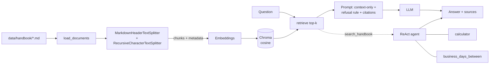

# Handbook RAG: retrieval-augmented QA and a ReAct agent

A small, testable project that answers questions about a company handbook **using only retrieved evidence**, refuses when the handbook does not contain the answer, and can solve multi-step questions by calling tools.

Built with Python, LangChain and Chroma. Models are pluggable: local Hugging Face, Ollama or OpenAI.

<!-- Add a screenshot: save it as docs/screenshot.png and uncomment the next line -->
<!--  -->

## What it does

- **RAG pipeline:** ingest, section-aware chunking, embeddings, Chroma (cosine) retrieval, and a grounded answer with `[n]` citations plus an explicit "I don't know" path.
- **ReAct agent:** a hand-written Thought / Action / Observation loop with three custom tools: `search_handbook`, `calculator` and `business_days_between`.
- **Web interface:** a Streamlit app with a question box, the retrieved passages, the agent's step-by-step trace, and a built-in evaluation tab.
- **Evaluation:** 24 labelled questions (factual, paraphrased and unanswerable) plus 4 multi-step agent questions, retrieval and answer metrics, and a chunk-size / overlap sweep.

The corpus (`data/handbook/`) is the handbook of a **fictional** company. That is deliberate: its facts are not in any model's training data, so a correct answer shows that retrieval worked, and an invented one is easy to spot.

## Architecture



| File | Responsibility |
|---|---|
| `handbook_rag/ingest.py` | load, two-stage split with `source` / `section` / `chunk_id` metadata, build and load Chroma |
| `handbook_rag/rag.py` | `RagPipeline`: retrieval, prompt, refusal rule, optional distance guard |
| `handbook_rag/agent.py` | ReAct loop: parsing, tool dispatch, error recovery, step limit |
| `handbook_rag/tools.py` | custom tools, including an AST-based safe calculator (no `eval`) |
| `handbook_rag/evaluate.py` | hit@k, ctx@k, MRR, answer accuracy, refusal metrics, sweep |
| `handbook_rag/providers.py` | embedding and LLM factories, plus offline stand-ins for tests |
| `app.py` | Streamlit web interface |
| `tests/` | 29 tests, including a scripted-LLM test of the whole agent loop |

## Quickstart

```bash
pip install -r requirements.txt
python -m pytest -q                       # 29 tests, no downloads needed
python -m handbook_rag ingest             # index the handbook
python -m handbook_rag ask "How many vacation days do I get?" --show-context
```

The default mode is an **offline demo** (hash embeddings and an extractive stand-in for the LLM). It exists so the tests and the plumbing run anywhere. Its answers are weak by design, so use a real model for meaningful output:

```bash
pip install langchain-huggingface sentence-transformers "transformers>=4.56" torch accelerate
export RAG_EMBEDDINGS=huggingface RAG_LLM=huggingface     # PowerShell: $env:RAG_EMBEDDINGS="huggingface"
python -m handbook_rag ingest
python -m handbook_rag ask "What is the hotel cap in London?" --show-context
python -m handbook_rag eval --out eval/results/run1.json
```

Other providers: `RAG_EMBEDDINGS=ollama RAG_LLM=ollama RAG_LLM_MODEL=qwen2.5:7b`, or `RAG_EMBEDDINGS=openai RAG_LLM=openai` with `OPENAI_API_KEY` set. Settings are environment variables (see `.env.example`): `RAG_CHUNK_SIZE`, `RAG_CHUNK_OVERLAP`, `RAG_TOP_K`, `RAG_EMBED_MODEL`, `RAG_LLM_MODEL`.

The agent needs a stronger model than the small default (a 3B or 7B model, Ollama or OpenAI):

```bash
python -m handbook_rag agent "What is the total of the referral bonus and the yearly learning budget?" --trace
python -m handbook_rag eval --agent --out eval/results/agent.json
```

## Web interface

```bash
streamlit run app.py          # opens http://localhost:8501
```

Three tabs: **Ask (RAG)** shows the cited answer and the retrieved passages with their distances; **Agent** shows each Thought / Action / Observation step; **Evaluation** runs the retrieval metrics, the full evaluation with a progress bar, and the chunk-size sweep. The sidebar switches embeddings, LLM, chunk size, overlap and top-k live, and the index is rebuilt automatically.

## Results

Evaluation set: 24 labelled questions, of which 15 are factual, 4 are paraphrased (little word overlap with the handbook) and 5 are unanswerable (the handbook says nothing, so the correct behaviour is to refuse). Answers are scored by keyword match against the expected facts. Run: `eval/results/run1.json`.

<!-- Confirm these two lines match the models you used for run1 -->
Setup: embeddings `sentence-transformers/all-MiniLM-L6-v2`, LLM `Qwen/Qwen2.5-1.5B-Instruct`, chunk size 500, overlap 50, top-k 4.

| Metric | Result | Meaning |
|---|---|---|
| hit@4 | 1.00 | a chunk from the right file is in the top 4 (19 of 19) |
| ctx@1 / ctx@2 / ctx@4 | 0.89 / 1.00 / 1.00 | the retrieved text contains the answer facts |
| MRR@4 | 1.00 | the right file is ranked first on every answerable question |
| Answer accuracy | 0.84 (16 of 19) | answerable questions answered correctly |
| False-refusal rate | 0.16 (3 of 19) | answerable questions where the model said "I don't know" |
| Refusal accuracy | 0.80 (4 of 5) | unanswerable questions correctly refused |
| Accuracy: factual / paraphrase | 0.87 (13 of 15) / 0.75 (3 of 4) | |

**Retrieval is not the bottleneck.** Every answerable question had its answer in the top-4 context (ctx@4 = 1.00), so all four failures come from the generation step.

### The four failures

| Question | Problem |
|---|---|
| q11: weekly on-call compensation | False refusal. The answer (€250 per week) was in the retrieved context |
| q14: yearly learning budget | False refusal. The answer (€1,500) was in the retrieved context |
| q17: a glass of wine at a client dinner? | False refusal. The model did not connect "wine" with the rule "alcohol is not reimbursable" |
| q21: annual bonus for engineers (unanswerable) | **Hallucination.** The model answered €2,000, which is the *referral* bonus, a different fact |

The last case is the failure RAG is meant to prevent: a nearby but different passage was presented as the answer. A refusal that is too eager and a hallucination that is too eager both come from a small model following the prompt's refusal rule imperfectly.

### Caveats

- The test set is small. One answerable question is worth about 5 points of accuracy and one unanswerable question 20 points, so a difference of one question between two runs is not evidence.
- Keyword scoring can mark a correct answer wrong if it is worded differently, and it cannot detect an answer that contains the right keyword for the wrong reason.
- All numbers come from a single run with greedy decoding.

### Chunk size and overlap

`python -m handbook_rag sweep` rebuilds the index for every chunk-size and overlap combination and reports retrieval metrics without calling the LLM. Output is saved in `eval/results/sweep.csv`. Overlap protects facts that would otherwise be cut at a chunk boundary; with section-aware splitting, most sections are already shorter than the chunk size, so it matters mostly for small chunks.

## Design decisions

- **Header-aware, then size-based splitting.** Policies are organised by section. Splitting on headers keeps one rule per chunk and gives each chunk a `section` label for citations.
- **Cosine distance.** Sentence-embedding models are trained for cosine similarity, and Chroma's default is L2.
- **Refusal rule in the prompt, plus an optional `max_distance` guard.** The prompt handles most unanswerable questions; the guard skips the LLM call when nothing relevant was retrieved. The threshold depends on the embedding model.
- **`ctx@k` next to `hit@k`.** With six documents, "the right file is in the top 4" is almost always true. Whether the answer text is actually in the retrieved context is the metric that exposes chunking problems and separates retrieval errors from generation errors.
- **Hand-written ReAct loop.** It works with models that have no native tool calling, and every failure mode is visible. A made-up `Observation:` from the model is cut off, bad JSON falls back to a plain string, unknown tools and tool exceptions become observations the model can recover from, and `max_steps` stops runaway loops.
- **Safe calculator.** Arithmetic is parsed with `ast` and whitelisted. There is no `eval`, and the tests include injection attempts.

## Limitations and next steps

- Tighten the refusal rule so that a passage about a different topic does not count as an answer (the q21 failure), then re-run the same evaluation and compare refusal accuracy.
- Try a larger LLM (3B / 7B) or a different embedding model to see how many of the false refusals disappear.
- Replace keyword scoring with an LLM judge or manual review, and grow the question set.
- Add a reranker (cross-encoder), hybrid BM25 plus vector search, PDF ingestion and conversation memory.
- `business_days_between` ignores public holidays, as its tool description says.

## Testing

```bash
python -m pytest -q      # 29 tests
```

The tests cover ingestion and chunk metadata, retrieval and the refusal path, the safe calculator (including injection attempts), the full agent loop with a scripted model, and the Streamlit app in offline mode. Real-model behaviour is covered by the evaluation above, not by the unit tests.
